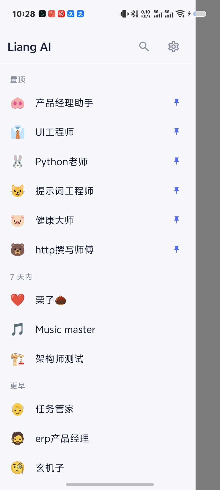
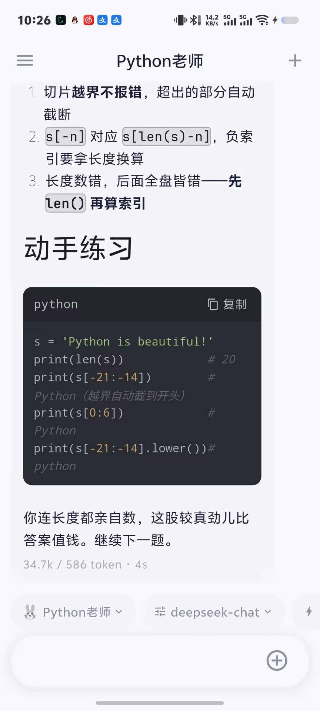
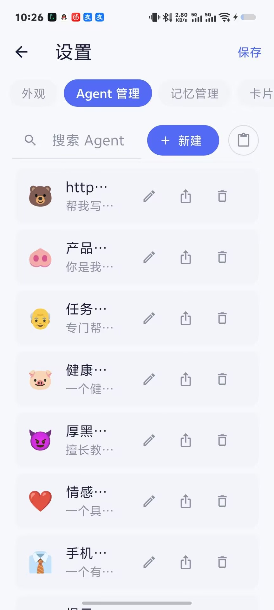
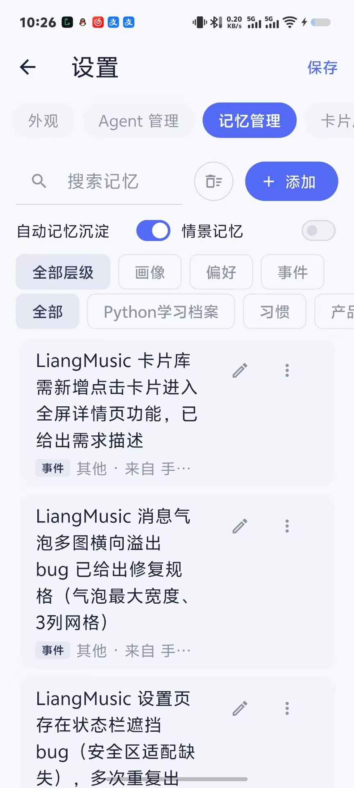
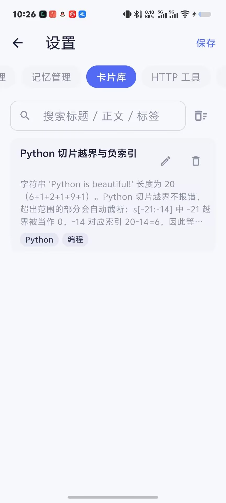

<div align="center">


# Liang AI

**Local-first AI assistant for Android — your chats, memories and keys stay yours**

[](https://github.com/lvliang666666/liang-ai/releases)
[](LICENSE)
[](https://www.android.com/)
[](https://flutter.dev/)

English | [简体中文](README.zh-CN.md)

[⬇️ Download](#-download) · [✨ Features](#-feature-overview) · [🔧 Tech Highlights](#-tech-highlights) · [🛠 Build from Source](#-build-from-source)

</div>

---

## 💡 Why Liang AI

Mainstream AI apps keep your conversations on someone else's servers and lock your memories inside their accounts.

**Liang AI is my one-person answer to that**: an AI assistant that runs entirely on your phone — chat history, long-term memory and knowledge cards all live in a local database, your API key is encrypted by Android system-level secure storage, and there is zero telemetry. Bring your own API key, connect to any OpenAI-compatible LLM service, and it becomes your own AI terminal.

From the first line of code to v2.30, one person handled product design, development, testing and releases — backed by a strict [versioning workflow](VERSIONING.md) and a living feature backlog. This is not a demo; it is a seriously maintained product.

## ✨ Core Highlights

- 🔌 **Any OpenAI-compatible model, plug and play** — OpenAI / DeepSeek / Moonshot / SiliconFlow / local Ollama… just enter a Base URL + Key, switch between multiple providers in one tap
- ⚡ **True streaming** — SSE token-by-token output, typewriter rendering, stop generation anytime; full Markdown and code-block syntax highlighting
- 🔒 **Local-first, private by default** — everything stored in local SQLite, API keys encrypted via Android Keystore-backed secure storage, zero telemetry, zero upload
- 🧠 **A memory system that grows with you** — memories auto-extracted after each session, layered by importance, pinnable as permanent, traceable back to the source conversation
- 🤖 **Agents as plain Markdown** — define personas and skills in a single Markdown file with YAML front matter; 10 built-in agents (translator, brainstorm, invoice extractor…), variable slots and structured output supported
- 🛡 **Generation survives the background** — foreground service + WakeLock keepalive: switch to WeChat or lock the screen, long answers still finish

## 📱 Screenshots

| Sessions | Streaming Chat | Agents |
|:---:|:---:|:---:|
|  |  |  |
| **Memory** | **Card Library** | |
|  |  | |

## 📥 Download

Grab the latest APK from the [**Releases page**](https://github.com/lvliang666666/liang-ai/releases/latest):

1. Download `app-release.apk`
2. Install (allow "install unknown apps" when prompted)
3. On first launch, go to **Settings → Model Service** and enter your API Base URL and Key

> Requires Android 5.0 (API 21) or above.

## ✨ Feature Overview

| Module | Capabilities |
|---|---|
| 💬 Chat | Multi-session management, pin/group sessions, SSE streaming, stop generation, Markdown + code highlighting |
| 🧠 Memory | Auto memory extraction, importance layering & decay, pinned permanent memories, source tracing, screenshot memory |
| 🤖 Agents | Markdown + YAML definitions, 10 built-in agents, variable-slot forms, output contracts (structured cards), persona presets |
| 🃏 Cards | Long-press any message to distill it into a card, auto title/tag extraction, search/edit/delete |
| 📄 Documents | PDF chunked indexing, relevance-based retrieval injection, answers cite "filename · page N" with jump-to-source |
| 🔍 Search | Full-text search over history sessions and memories (`search_history` tool) |
| 🌅 Proactive | Daily morning briefing (with "last week recap"), commitment follow-ups (extracted todos get a gentle next-day nudge, anti-disturbance built in) |
| 🧩 Tools | Built-in tools (device info / battery / hashing), custom HTTP tools, transparent tool-call visualization |
| 📱 Widget | Home-screen widget: recent sessions + quick new chat + today's briefing |
| 🔐 Security | API keys in Keystore-encrypted storage, local database, no telemetry |
| 💾 Data | One-tap backup/restore (memories & cards included), export Markdown/HTML to Downloads, system share receiving |

## 🔧 Tech Highlights

| | |
|---|---|
| **Pure-Dart orchestrator** | The agentic loop is extracted into a Flutter-independent `ChatOrchestrator` — takes messages + service dependencies, emits an event stream, fully unit-testable with fake services (1158+ tests kept green) |
| **SSE pipeline** | Hand-written SSE parser + Dio `CancelToken` for stop-generation; streaming rendering fully decoupled from the network layer |
| **Key hardening** | API keys live in `flutter_secure_storage` (Android Keystore-encrypted EncryptedSharedPreferences); the database stores only an empty string — even a leaked DB yields no keys |
| **Background keepalive** | `flutter_foreground_task` foreground service (dataSync type) + WakeLock keep SSE streams alive across short background trips |
| **Local full-text search** | SQLite-backed FTS over sessions and memories; the model can actively call the `search_history` tool |
| **Engineered workflow** | Versioning spec + feature backlog + acceptance ledger: every feature is traceable to its requirement and acceptance record |

## 🛠 Build from Source

```bash
# 1. Requirements: Flutter SDK (Dart SDK >= 3.12.2), Android SDK (minSdk 21)
git clone https://github.com/lvliang666666/liang-ai.git
cd liang-ai

# 2. Fetch dependencies
flutter pub get

# 3. Run tests (optional, 1158+ cases)
flutter test

# 4. Build release APK
flutter build apk --release
# Output: build/app/outputs/flutter-apk/app-release.apk
```

> Note: `dependency_overrides` pins `shared_preferences_android 2.4.28` (2.5.x causes a startup white-screen in release builds — see comments in [pubspec.yaml](pubspec.yaml)). Do not remove it casually.

## 🗺 Roadmap (Planned)

The following directions are in the [feature backlog](docs/ROADMAP.md), not yet scheduled:

- Memory v2: deeper curation → auto-distillation → layered decay
- Proactive intelligence engine: a fuller briefing & commitment follow-up loop
- Layered context compression: cost & quality optimization for long sessions

> Scope promise: this README only describes features that are **implemented and accepted**. Planned items are never oversold.

## ⚠️ Disclaimer

- This app ships with **no model service** — bring your own API key; usage and costs are charged by your chosen provider, not this project
- AI-generated content may be wrong; use your own judgment
- Provided "as is" under the MIT license — see [LICENSE](LICENSE)

## 🤝 Contributing

Bug reports and feature suggestions are welcome via [Issues](https://github.com/lvliang666666/liang-ai/issues). Given the strict versioning and acceptance workflow, please open an Issue to discuss before large PRs.

## ⭐ Support

If Liang AI helps you, a **Star** ⭐ means the world to a solo developer — and helps more people discover this project.

---

<div align="center">

**Liang AI** · One person's craft, your own AI terminal

</div>
