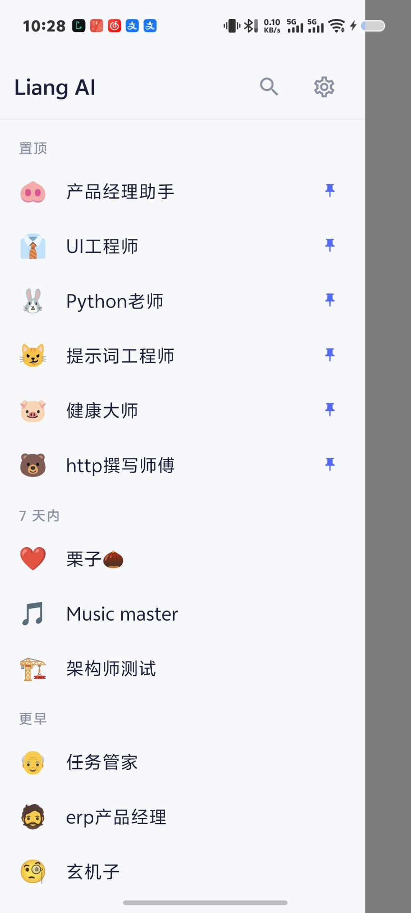
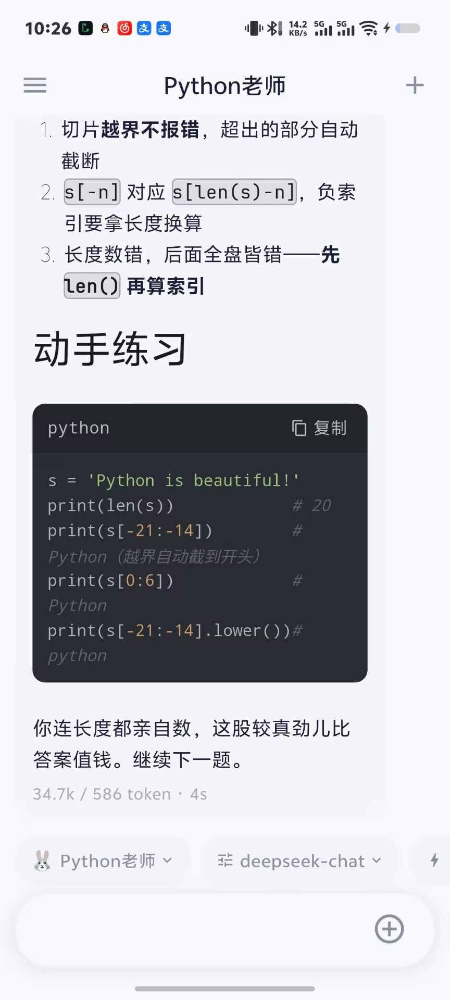
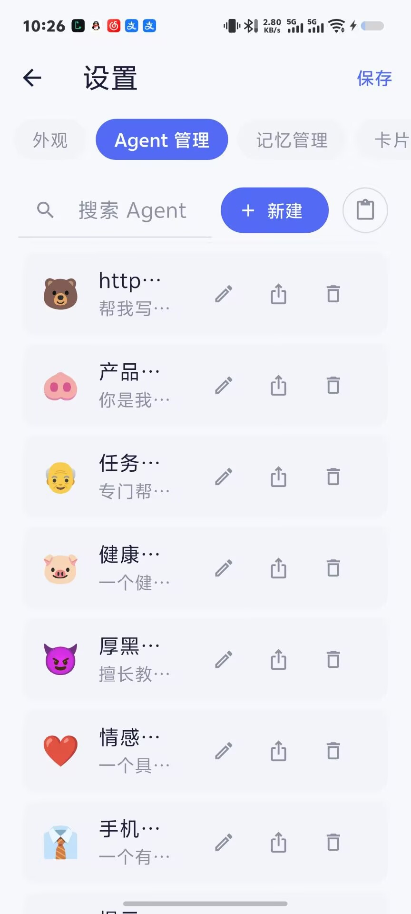
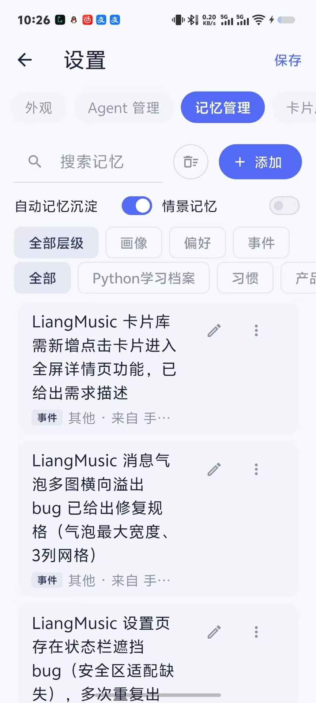
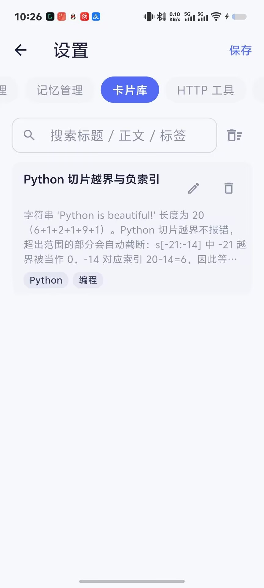

<div align="center">


# Liang AI

**本地优先的 Android AI 助手 —— 你的对话、记忆与密钥，只属于你**

[](https://github.com/lvliang666666/liang-ai/releases)
[](LICENSE)
[](https://www.android.com/)
[](https://flutter.dev/)

[English](README.md) | 简体中文

[⬇️ 下载 APK](#-下载安装) · [✨ 功能总览](#-功能总览) · [🔧 技术亮点](#-技术亮点) · [🛠 从源码构建](#-从源码构建)

</div>

---

## 💡 为什么做 Liang AI

主流 AI 应用把你的对话存在别人的服务器上，把你的记忆锁在它们的账号体系里。

**Liang AI 是我一个人的回答**：一个完全跑在你手机上的 AI 助手——对话记录、长期记忆、知识卡片全部存在本地数据库，API Key 用 Android 系统级安全存储加密，没有任何遥测和上传。你带上自己的 API Key，接上任意 OpenAI 兼容的大模型服务，它就是一台属于你自己的 AI 终端。

从第一行代码到 v2.30，一个人完成产品设计、开发、测试与发版，沉淀了完整的[版本管理规范](VERSIONING.md)与需求池机制。它不是 demo，是一个被认真维护的产品。

## ✨ 核心特性

- 🔌 **任意 OpenAI 兼容模型即插即用** — OpenAI / DeepSeek / 月之暗面 / 硅基流动 / 本地 Ollama……填入 Base URL + Key 即可对话，多 Provider 配置一键切换
- ⚡ **真·流式体验** — SSE 逐字输出、打字机渲染、随时停止生成；Markdown / 代码块高亮完整支持
- 🔒 **本地优先，隐私默认** — 数据全部存本地 SQLite，API Key 存 Android Keystore 加密的系统安全存储，零遥测、零上传
- 🧠 **会成长的记忆系统** — 对话结束自动提取记忆候选，重要度分层、置顶永久记忆、可溯源跳回原对话，越用越懂你
- 🤖 **Agent 即提示词** — 用一个 Markdown 文件（YAML front matter）定义人格与技能，内置翻译、头脑风暴、账单提取等 10 个 Agent，支持变量插槽与结构化输出
- 🛡 **后台生成不断流** — 前台服务 + WakeLock 保活，切回微信、锁屏，长回答照样生成完毕

## 📱 截图预览

| 会话列表 | 流式对话 | Agent 管理 |
|:---:|:---:|:---:|
|  |  |  |
| **记忆管理** | **卡片库** | |
|  |  | |

## 📥 下载安装

前往 [**Releases 页面**](https://github.com/lvliang666666/liang-ai/releases/latest) 下载最新 APK：

1. 下载 `app-release.apk`
2. 安装（需允许「安装未知来源应用」）
3. 首次启动后进入「设置 → 模型服务」，填入你的 API Base URL 与 Key

> 系统要求：Android 5.0（API 21）及以上

## ✨ 功能总览

| 模块 | 能力 |
|---|---|
| 💬 对话 | 多会话管理、置顶/分组、SSE 流式输出、停止生成、Markdown + 代码高亮渲染 |
| 🧠 记忆 | 自动记忆提取、重要度分层与衰减、置顶永久记忆、来源溯源、截图记忆 |
| 🤖 Agent | Markdown+YAML 定义、10 个内置 Agent、变量插槽表单、输出契约（结构化卡片）、人格预设 |
| 🃏 卡片库 | 长按消息「沉淀为卡片」、自动提炼标题/标签、搜索/编辑/删除 |
| 📄 文档 | PDF 分块索引、按相关性检索注入、回答标注「文件名·第 N 页」可跳原文 |
| 🔍 检索 | 全文检索历史会话与记忆（`search_history` 工具） |
| 🌅 主动智能 | 每日晨报（含「上周回顾」）、承诺跟进（提取待办次日追问，防打扰可关） |
| 🧩 工具 | 内置工具（设备信息/电量/哈希计算）、自定义 HTTP 工具、工具调用过程透明可见 |
| 📱 小组件 | 桌面 Widget：最近会话直达 + 快速新对话 + 今日简报 |
| 🔐 安全 | API Key 存 Android Keystore 加密存储、本地数据库、无遥测 |
| 💾 数据 | 一键备份/恢复（含记忆与卡片）、导出 Markdown/HTML 到下载目录、系统分享接收 |

## 🔧 技术亮点

| | |
|---|---|
| **纯 Dart 编排器** | Agentic loop 抽离为不依赖 Flutter 的 `ChatOrchestrator`，输入消息 + 服务依赖、输出事件流，可用假服务做单元测试（全量 1158+ 测试保持绿色） |
| **SSE 流水线** | 自研 SSE 解析器 + Dio CancelToken 停止生成，流式渲染与网络层解耦 |
| **密钥加固** | API Key 存 `flutter_secure_storage`（Android Keystore 加密的 EncryptedSharedPreferences），数据库只存空串——拖库也拿不到 Key |
| **后台保活** | `flutter_foreground_task` 前台服务（dataSync 类型）+ WakeLock，短时切后台 SSE 流不断 |
| **本地全文检索** | SQLite FTS 支撑历史会话与记忆检索，模型可主动调用 `search_history` 工具 |
| **工程化流程** | 版本管理规范 + 需求池 + 验收台账三件套，每个功能可追溯到需求来源与验收记录 |

## 🛠 从源码构建

```bash
# 1. 环境要求：Flutter SDK（Dart SDK ≥ 3.12.2）、Android SDK（minSdk 21）
git clone https://github.com/lvliang666666/liang-ai.git
cd liang-ai

# 2. 拉取依赖
flutter pub get

# 3. 运行测试（可选，全量 1158+ 用例）
flutter test

# 4. 构建 Release APK
flutter build apk --release
# 产物位于 build/app/outputs/flutter-apk/app-release.apk
```

> 注意：项目通过 `dependency_overrides` 锁定了 `shared_preferences_android 2.4.28`（2.5.x 在 release 构建下存在启动白屏问题，详见 [pubspec.yaml](pubspec.yaml) 注释），请勿随意移除。

## 🗺 Roadmap（规划中）

以下方向已进入[需求池](docs/ROADMAP.md)，尚未排期：

- 记忆二期：策展台 → 自动沉淀 → 分层衰减的进一步深化
- 主动智能引擎：更完整的晨报与承诺跟进闭环
- 分层上下文压缩：长会话的成本与质量优化

> 功能边界承诺：README 只描述**已实现并验收**的功能，规划中的能力不会提前「画饼」。

## ⚠️ 免责声明

- 本 App 不内置任何模型服务，需**自备 API Key**，用量与费用由你选择的服务商收取，与本项目无关
- AI 生成内容可能存在错误，请自行判断后再采纳
- 本项目按「现状」提供，使用 MIT 协议开源，详见 [LICENSE](LICENSE)

## 🤝 参与贡献

欢迎通过 [Issues](https://github.com/lvliang666666/liang-ai/issues) 反馈 Bug、提出功能建议。由于项目采用严格的版本管理与验收流程，大型 PR 请先开 Issue 讨论方案。

## ⭐ 支持一下

如果 Liang AI 对你有帮助，欢迎点一个 **Star** ⭐ —— 这是对独立开发者最直接的支持，也让更多人看到这个项目。

---

<div align="center">

**Liang AI** · 用一个人的认真，做一台属于你自己的 AI 终端

</div>
